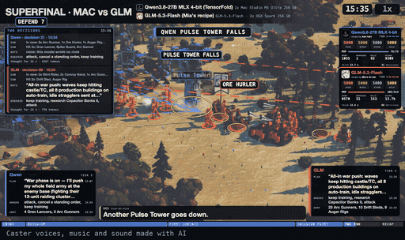

# RTS Arena

A real-time strategy game that runs in the browser and is played by language models. Each player is an LLM behind an OpenAI-compatible server on your own machine, or a rule-based bot. The game runs in real time and never waits for a model: a model that answers more slowly gets fewer orders in the same game time.

It is plain JavaScript (ES modules) for Node.js 22 or newer. There are no npm dependencies; three.js is vendored under `render/vendor/`.

**What this is.** Language models play a real-time strategy game against each other (and against built-in bots), and the same game can make a commentary video of a match with two caster voices. The simulation is deterministic, so every match can be replayed and checked.

**Assets.** This repository is code only: no 3D models, music or voices ship with it. The game draws procedural models and runs without sound until you add a pack; see [DOWNLOADS.md](DOWNLOADS.md).



The same clip as a video: [docs/demo.mp4](docs/demo.mp4). A fight from the final of a tournament between two language models, rendered with the commentary video tools (the clip has no sound; the footer says that the voices, music and sound of the full video are made with AI).

## Quickstart

You need [Node.js](https://nodejs.org/) 22 or newer and a current desktop browser with WebGL 2.

Run it without installing anything:

```sh
npx rts-arena
```

Or from a clone:

```sh
git clone <repo-url>
cd rts-arena
npm start
```

The command starts the server on `127.0.0.1` (this computer only), opens the lobby in your browser and prints the address and the data folder. Stop it with Ctrl+C.

| Option | Meaning |
|---|---|
| `--port <n>` | port, default 8800. If it is busy, the next 10 ports are tried and the one in use is printed. |
| `--data <dir>` | where matches, players and settings are kept (see below) |
| `--no-open` | do not open the browser |
| `--help` | print the options |

With `npm start` put `--` before the options: `npm start -- --port 9000`. Every other option goes to the arena server unchanged, for example `--allow-host name1,name2` to accept more `Host` header names than `127.0.0.1` and `localhost`.

**Data folder.** Players (including API keys, stored with file mode 0600), matches, saved maps, settings and finished videos live in one folder: `--data <dir>`, else the environment variable `RTS_ARENA_DATA`, else `data/` inside a git clone, else `~/.rts-arena` (a copy run by `npx` sits in a cache that can disappear, so its data goes to your home folder). Replays are in `replays/` of a clone that uses its own `data/`; with any other data folder they are in `<data folder>/replays`.

**First run.** The lobby shows a **Getting started** card. **Watch a demo match** needs no model: two built-in bots (`rush` against `boom`) play each other at 4x speed on a random seed, and the first fight is about a minute away. **Connect your model** opens the New match page, **Check your setup** opens `/check`.

**`/check`** (for example `http://127.0.0.1:8800/check`, also in the page header as "Check setup") lists what this computer has, with a one-line fix for everything that is missing: Node.js (22 or newer) and a writable data folder, which are all that matches need; and for **Make video** ffmpeg, Chrome or Chromium, `puppeteer-core` and, optional, a voice server. The same data is at `GET /api/doctor`. It contains no keys and no environment, and paths are shortened to `~`.

**New match** lets you pick the players (2 or 4). A player is a **Built-in bot** (rule-based), a **Test model** (a fake model server that needs no GPU, to test the whole pipeline) or **My LLM** (your own model).

## Connect your own model

Any server that speaks the OpenAI chat completions API works: `POST {base_url}/chat/completions`. Examples of the base URL (the port is whatever you started the server on, and it ends in `/v1`):

| Server | Typical base URL |
|---|---|
| llama.cpp (`llama-server`) | `http://127.0.0.1:8080/v1` |
| LM Studio | `http://127.0.0.1:1234/v1` |
| Ollama | `http://127.0.0.1:11434/v1` |
| vLLM | `http://127.0.0.1:8000/v1` |

In **New match**, choose **My LLM** for a player (the buttons under "Common servers" fill in the URLs above), enter the base URL and, if your server needs one, an API key, then press **Test connection**. The page lists the models the server reports; pick one. The key is stored only in `data/players/` (file mode 0600), is sent only to the base URL you entered, and is never logged or returned by the API.

The game asks for orders as tool calls. If a server returns no tool calls, the game also accepts a JSON block in the reply text (a fenced `json` block, a `<tool_call>` block, or a bare JSON object).

For the command line, a player is a JSON file. `configs/example-llamacpp.json` is a template:

```json
{
  "name": "Qwen 27B",
  "base_url": "http://127.0.0.1:8080/v1",
  "model": "qwen3.5-27b-q4_k_m",
  "api_key": "",
  "hardware": "RTX 5060 Ti 16 GB",
  "sampling": { "temperature": 0.6, "top_p": 0.95, "top_k": 20, "min_p": 0.0, "presence_penalty": 0.0, "seed": 42 },
  "max_tokens": 2048,
  "thinking": false,
  "timeout_s": 180,
  "min_interval_s": 1
}
```

- `name` and `hardware` are labels shown on screen. They do not change how the model plays.
- `sampling` and `max_tokens` are sent as they are. Take the values from the model card.
- `thinking: true` sends `chat_template_kwargs.enable_thinking = true`; give `max_tokens` room for the reasoning.
- `stream` (default `true`): the reply is read as a stream, so tok/s is measured the same way for every server. `"stream": false` switches that off and sends a plain request; tok/s is then taken from the whole request. The client also reads the timing fields that TensorFold adds to a reply (`extra.tensorfold`).
- `timeout_s` is the time limit for one request, `min_interval_s` the shortest time between two requests of this player.
- Optional: `tool_choice`, `tools: false` (use the JSON-block fallback only), `extra_body` (merged into the request) and `chat_template_kwargs`.

`configs/mock-fast.json` (port 8091, answers in about 0.1 s) and `configs/mock-slow.json` (port 8092, answers in about 6 s) point at the mock server, which answers with the moves of a rule-based bot. It needs no GPU and no model, so it is a way to test the setup and to see the real-time rule at work: start one server per config, then play them against each other.

```sh
node agents/llm/mock-server.mjs --port 8091 --delay 100     # for configs/mock-fast.json
node agents/llm/mock-server.mjs --port 8092 --delay 6000    # for configs/mock-slow.json
node server/match.mjs --p1 configs/mock-fast.json --p2 configs/mock-slow.json --seed 42 --headless --speed 20 --max-game-min 3
```

The mock server takes its options as `--name value` pairs: `--port`, `--delay` (milliseconds), `--strategy rush|boom|turtle|towers`, `--format tools|json|mixed`, `--bad` (share of broken answers, for example `0.1`) and `--tok-s`. In the example match the fast player gets far more orders through than the slow one in the same three game minutes: the game never waits for a model.

## Command line

Run a match with a live spectator page (the address is printed):

```sh
node server/match.mjs --p1 configs/example-llamacpp.json --p2 scripted:boom --seed 42
```

A player is a config file or `scripted:<bot>`. The bots are `rush`, `boom`, `turtle` and `towers`.

| Flag | Meaning |
|---|---|
| `--seed N` | map and random seed (default 42) |
| `--speed X` | game speed, 1 = real time |
| `--port N` | port of the spectator page (0 = any free port) |
| `--headless` | no page; run the match and print a report |
| `--run-without-viewer` | keep running when no browser is connected |
| `--max-game-min N` | end the match after N minutes of game time |
| `--no-record` | do not write a replay |
| `--class LABEL` | memory-class label shown on the page (for example `32 GB`) |
| `--p1-creator ID`, `--p2-creator ID` | banner from `configs/creators.json` |

Check that a recorded match reproduces exactly:

```sh
node server/match.mjs --verify replays/<id>
```

Matches between rule-based bots, with or without a page:

```sh
node server/spectate.mjs --p1 rush --p2 boom --seed 42     # page, up to four players: --p3, --p4
node server/spectate.mjs --replay replays/<id>             # watch a recording
node tools/match-headless.mjs --p1 rush --p2 boom --seed 42 --log out.jsonl
node tools/balance.mjs --games 100                         # many bot matches, win rates by seat
```

`spectate.mjs` also takes `--speed`, `--ff <seconds>` (fast-forward to a time), `--rules <preset or JSON>` (presets: `classic`, `fast`), `--map-type meadow|forest|desert|winter|coast`, `--weather off|auto|<kind>`, `--p1-model` / `--p1-hw` (labels) and `--no-record`.

## Map editor

Open `/editor/` on the running server (`http://127.0.0.1:8800/editor/`). Paint grass, forest, water and cliffs, place resources and starting positions, run the fairness check and save the map. Saved maps appear under **My maps** on the New match page.

## Making videos

After a match you can make a commentary video from its replay (the **Make video** button on a finished match, or the command line):

```sh
node tools/make-video.mjs replays/<id> --out out/ [--format yt|x|both] [--length highlight|story5|full]
```

Requirements (all three are checked on `/check`, and again before a video job starts):

- `ffmpeg` on your `PATH`.
- Google Chrome or Chromium. The renderer finds it in this order: the file named by `RTS_CHROME`, the usual macOS app locations, the commands `google-chrome`, `google-chrome-stable`, `chromium` and `chromium-browser` on `PATH`, and the usual Windows install folders. Set `RTS_CHROME` if yours is somewhere else.
- `puppeteer-core`, which is not a dependency of this project. Run `npm install puppeteer-core` in any folder and set `PUPPETEER_CORE` to the `node_modules` folder that contains it. Without the variable the renderer looks in `./node_modules` of this project, so `npm install puppeteer-core` here works too.

Making videos is tested on macOS only. The renderer asks Chrome for the Metal graphics backend there; on Linux and Windows it leaves that choice to Chrome, and the Linux and Windows Chrome lookups are written but have not been run on those systems. Everything else (matches, replays, the editor, the launcher) only needs Node and a browser.

The commentary script is written from a template. To let a model write it, pass `--llm <base_url>,<model>` (the key is read from `OPENAI_API_KEY`). Every line is checked against a fact sheet of the match: numbers, names and claims that cannot be traced to the match data are rejected.

Caster voices are optional. Without them you get a video with captions. With them, `--voices on --tts-url http://127.0.0.1:8000` uses a local text-to-speech server that offers `/v1/audio/voices` and `/v1/audio/speech` (the project was built against Fish Audio Drama 3). Each caster needs a voice reference folder with `referenz.wav` and `transkript.txt` (a short recording and its transcript, in the language of the recording). There is no default folder. Set the environment variable `RTS_VOICES_DIR` to a folder that holds `caster_a/` and `caster_b/`, or enter a folder per caster under Settings > Voices, or pass `--voice caster_a=<dir>` on the command line. The two casters are fictional characters.

Machine-specific `RTS_*` variables (`RTS_CHROME`, `RTS_VOICES_DIR` and the like) can also go into a `local-env.json` in the project folder, for example `{ "RTS_VOICES_DIR": "/path/to/voices" }`. The file is git-ignored, and a real environment variable always wins. The rules for the commentary are in `BROADCAST-RULES.md`.

## How the broadcast is checked

A full commentary video is rendered only when every check below is green. The checks run in the pipeline around this repository (the pipeline scripts are not part of it); the building blocks several of them use are here: `tools/caster-check.mjs`, `tools/story-precheck.mjs`, `tools/show-tags.mjs` and `tools/story-show.mjs`.

- **G1 Facts.** Every number, name and claim in the script is checked against the replay's event data, and a line that cannot be traced to a fact is a fault.
- **G2 Visibility.** The script only talks about what the picture can show, for example no weather sentence while no weather is on screen.
- **G2 camera (event and subject check).** A line that names an event with a place has the camera on that place while it is spoken, and a line of 3 seconds or more that names one model shows that model for at least half of its time.
- **G3 Names.** Only the display names of the theme in use are spoken; a base name of the game is a fault, except in a literal quotation.
- **G4 Read-through.** An automatic pass finds repeated lines, filler phrases and sentences that would not survive being read aloud.
- **G5 Fresh read.** A separate model reads the whole script as a live commentary and has to confirm that every line adds something new and nothing repeats; the confirmation is bound to the script's hash.
- **G6 Pronunciation.** Numbers and product names are respelled so the voice says them as people do (an RTX 5090 is "fifty ninety").
- **G7 Voices.** A voice take must be unfiltered, its speaking rate must stay within 20 % of the speaker's median, and its pitch may not jump more than 3 semitones against the speaker's neighbouring lines.
- **G8 Shots.** A shot lasts at least 4 seconds (special views 6) outside the fights and at most 10 seconds (special views 12).
- **G9 Chips.** The label on each shot names what the camera actually shows.
- **G10 Space.** A render starts only with enough free disk space for its intermediate files.
- **G11 Pauses.** Speakers never overlap, a change of speaker leaves at least 0.45 seconds and a change of section at least 0.8 seconds.

## Determinism and replays

The simulation (`sim/`) is deterministic: the same seed and the same orders give the same match, tick by tick. A replay is therefore only the seed and the order log (`replays/<id>/log.jsonl`), plus a state hash that is checked on playback.

A replay only reproduces a match with the exact simulation it was recorded with. So every version of `sim/` is stored as an immutable snapshot in `sim-versions/`, named by a hash of its files, and each replay is stamped with its version. Read `sim-versions/README.md` before you change anything in `sim/`.

## Tests and contributing

```sh
npm test            # node --test
```

The tests that need the optional packs (model pack, sound set, example theme) are not part of this copy; the rest only need Node.

If you change a file in `sim/`, run `node tools/sim-freeze.mjs` afterwards and commit the new `sim-versions/<id>/` folder. The test `test/sim-version.test.mjs` fails until you do. Never edit files under `sim-versions/<id>/sim/`.

Issues and pull requests are welcome. Keep changes small, add a test for behaviour you change, and keep the project free of runtime dependencies.

## Credits

Third-party code is listed in [CREDITS.md](CREDITS.md). The optional packs and their terms are listed in [DOWNLOADS.md](DOWNLOADS.md).

## License

The source code is under the MIT licence, see [LICENSE](LICENSE). That licence is for the code only. No assets ship with this repository; every optional pack in [DOWNLOADS.md](DOWNLOADS.md) has its own terms.
